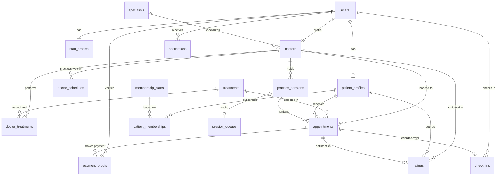

# TECH.md - Technical Architecture & Deep Dive Specification

> **System:** ARHE Clinic Appointment API (`arhe-api`)  
> **Target Audience:** Software Architects, Lead Engineers, and Technical Reviewers  
> **Last Updated:** 2026-11-04  

---

## 📑 Table of Contents

1. [Architectural Overview & High-Level Design](#1-architectural-overview--high-level-design)
2. [Data Layer & Persistence Engine](#2-data-layer--persistence-engine)
   - [Database Selection & Driver Adapter](#database-selection--driver-adapter)
   - [Entity-Relationship Diagram (ERD)](#entity-relationship-diagram-erd)
   - [Indexing & Query Optimization](#indexing--query-optimization)
3. [Concurrency Control & Quota Management](#3-concurrency-control--quota-management)
   - [The Overselling / Overbooking Problem](#the-overselling--overbooking-problem)
   - [Pessimistic Row Locking (`SELECT ... FOR UPDATE`)](#pessimistic-row-locking-select--for-update)
   - [Atomic Quota State Machine](#atomic-quota-state-machine)
   - [Lazy Expiration Synchronizer (`syncStatuses`)](#lazy-expiration-synchronizer-syncstatuses)
4. [Weekly Scheduling & Dynamic Session Generator](#4-weekly-scheduling--dynamic-session-generator)
   - [Schedule Overlap Detection Algorithm](#schedule-overlap-detection-algorithm)
   - [Session Materialization on First Booking](#session-materialization-on-first-booking)
5. [Authentication, Authorization & Security Pipeline](#5-authentication-authorization--security-pipeline)
   - [Stateless JWT via HTTP-Only Cookies](#stateless-jwt-via-http-only-cookies)
   - [Role-Based Access Control (RBAC) Matrix](#role-based-access-control-rbac-matrix)
   - [CORS & Attack Surface Mitigation](#cors--attack-surface-mitigation)
6. [Storage & Media Ingestion Pipeline](#6-storage--media-ingestion-pipeline)
   - [Ephemeral Memory Streaming via Multer](#ephemeral-memory-streaming-via-multer)
   - [Supabase Object Storage Integration](#supabase-object-storage-integration)
7. [Timezone Normalization Strategy (WIB / UTC)](#7-timezone-normalization-strategy-wib--utc)
8. [Error Handling & API Envelope Standards](#8-error-handling--api-envelope-standards)
9. [Deployment & Infrastructure Topology](#9-deployment--infrastructure-topology)
10. [Unified Database Architecture & Frontend Integration](#10-unified-database-architecture--frontend-integration)

---

## 1. Architectural Overview & High-Level Design

The application implements a **Layered Modular Architecture** following Domain-Driven principles partitioned into feature packages.

```
                      ┌────────────────────────────────────────┐
                      │             Client Requests            │
                      │       (Next.js / SPA / Mobile)         │
                      └───────────────────┬────────────────────┘
                                          │ HTTPS (JSON / Multipart)
                                          ▼
                      ┌────────────────────────────────────────┐
                      │            Global Middlewares          │
                      │  CORS • JSON Body • Cookies • Auth RBAC│
                      └───────────────────┬────────────────────┘
                                          │
                  ┌───────────────────────┴───────────────────────┐
                  ▼                                               ▼
      ┌────────────────────────┐                     ┌────────────────────────┐
      │  Appointment Feature   │                     │    Master Features     │
      │ Controllers • Services │                     │ Doctor • Schedule • Spc│
      └───────────┬────────────┘                     └───────────┬────────────┘
                  │                                               │
                  │              ┌────────────────┐               │
                  ├─────────────►│  Lib & Helpers ├───────────────┤
                  │              │  JWT • Time    │               │
                  │              └────────────────┘               │
                  ▼                                               ▼
      ┌───────────────────────────────────────────────────────────────────────┐
      │               Prisma ORM 7 Engine + pg Adapter Pool                   │
      └───────────────────────────────────┬───────────────────────────────────┘
                                          │
                         ┌────────────────┴────────────────┐
                         ▼                                 ▼
             ┌───────────────────────┐         ┌───────────────────────┐
             │ PostgreSQL (Supabase) │         │ Supabase S3 Storage   │
             │ Relational Data & ACID│         │ Doctor Photos & Slips │
             └───────────────────────┘         └───────────────────────┘
```

### Core Design Principles:
1. **Stateless Compute**: Zero state is stored in memory or on local disk; all session tokens are decoded from JWT cookies and files are buffered in RAM before shipping to object storage. Compatible with AWS Lambda and Vercel serverless functions.
2. **Pessimistic Concurrency**: Eliminates race conditions on doctor quota bookings through transactional database-level row locks.
3. **Explicit Type Validation**: Pure separation between input validation (`Zod`), data transformation (`Services`), and transport serialization (`Controllers`).

---

## 2. Data Layer & Persistence Engine

### Database Selection & Driver Adapter
- **Engine**: PostgreSQL 15+
- **Prisma Client Generation**: Generated to `src/generated/prisma` using `@prisma/client` and `@prisma/adapter-pg`.
- **Driver Adapter**: Connects via `pg` (`Pool`) configured in `src/configs/prisma-client.config.ts`, enabling connection pooling support for both standard and serverless execution environments.

### Entity-Relationship Diagram (ERD)



### Indexing & Query Optimization

| Table | Index Columns | Purpose |
|---|---|---|
| `users` | `(role, is_active)` | Fast filtering for active staff/doctors/admins |
| `appointments` | `(session_id, queue_number)` | Unique constraint ensuring queue numbers are never duplicated per session |
| `appointments` | `(patient_id, status)` | Fast retrieval for patient appointment history dashboards |
| `appointments` | `(doctor_id, status)` | Doctor appointment scheduling queries |
| `appointments` | `(status, payment_deadline)` | Optimized lookup for the `syncStatuses` lazy-expiry background loop |
| `doctor_schedules`| `(doctor_id, day_of_week, start_time)` | Unique constraint preventing duplicate slot creation |
| `doctor_schedules`| `(day_of_week, is_active)` | Fast lookup of active doctors practicing on a given weekday |
| `practice_sessions`| `(doctor_id, session_date, start_time)` | Unique constraint guaranteeing exactly 1 session record per doctor slot date |
| `payment_proofs` | `(verification_status)` | Instant filtering for admin verification queue |

---

## 3. Concurrency Control & Quota Management

### The Overselling / Overbooking Problem
When multiple patients attempt to book the final available quota slot for a doctor simultaneously, standard `SELECT COUNT(*)` followed by `INSERT` suffers from a **Time-of-Check to Time-of-Use (TOCTOU)** race condition.

### Pessimistic Row Locking (`SELECT ... FOR UPDATE`)
To guarantee 100% atomicity, the system uses PostgreSQL explicit row-level locks via `prisma.$queryRaw`:

```typescript
// Located in src/features/appointment/appointment.helpers.ts
export const lockSession = async (tx: Tx, sessionId: string) => {
  await tx.$queryRaw`
    SELECT id FROM practice_sessions 
    WHERE id = ${sessionId} 
    FOR UPDATE
  `;
};
```

When a booking transaction begins:
1. The transaction acquires an exclusive lock on the `practice_sessions` row for that specific date and doctor.
2. Concurrent booking requests for the same session are queued in PostgreSQL's lock manager (`pg_locks`).
3. Inside the lock, `holdsQuota` counts the exact active bookings.
4. If `activeBookings >= session.patient_quota`, the transaction aborts with HTTP `409 Conflict ("Doctor schedule quota is full")`.
5. The lock is released only when the transaction commits or rolls back.

### Atomic Quota State Machine

An appointment is evaluated for whether it consumes quota using the `holdsQuota` predicate:

$$\text{holdsQuota}(a) = (a.\text{status} \in \{\text{waiting\_confirmation}, \text{done}\}) \lor (a.\text{status} = \text{waiting\_payment} \land a.\text{payment\_deadline} > \text{now})$$

```
                     ┌───────────────────┐
                     │  Quota Available  │
                     └─────────┬─────────┘
                               │ POST /appointments (Within 14 days)
                               ▼
                   ┌───────────────────────┐
                   │    waiting_payment    │ ◄── [HOLDS QUOTA for 30 mins]
                   └───────┬───────┬───────┘
          Expired (>30m)   │       │ Payment Proof Uploaded
                 ┌─────────┘       ▼
                 ▼        ┌──────────────────────┐
            ┌─────────┐   │ waiting_confirmation │ ◄── [HOLDS QUOTA indefinitely]
            │ expired │   └───────┬───────┬──────┘
            └─────────┘           │       │ Admin Rejection
        [QUOTA RELEASED]  Approve │       ▼
                                  │   ┌──────────┐
                                  │   │ rejected │ ──► [QUOTA RELEASED]
                                  ▼   └──────────┘
                              ┌──────┐
                              │ done │ ◄── [HOLDS QUOTA; Queue & QR Assigned]
                              └──────┘
```

### Lazy Expiration Synchronizer (`syncStatuses`)
Instead of requiring an external heavy cron daemon, the system runs an optimized lazy sync:

```typescript
export const syncStatuses = async (db = prisma) => {
  await db.appointments.updateMany({
    where: {
      status: 'waiting_payment',
      payment_deadline: { lte: new Date() },
    },
    data: { status: 'expired' },
  });
};
```
This is executed before:
- Checking availability (`GET /appointments/availability`)
- Creating an appointment (`POST /appointments`)
- Admin viewing or approving appointments

Because the `(status, payment_deadline)` compound index exists, this query executes in sub-millisecond time.

---

## 4. Weekly Scheduling & Dynamic Session Generator

### Schedule Overlap Detection Algorithm
Doctors configure weekly practice hours using day-of-week indices (`0` = Sunday, ..., `6` = Saturday). To prevent overlapping time slots for the same doctor, the system executes an interval collision query in `ScheduleService`:

$$\text{Overlap} \iff (\text{Existing.start} < \text{New.end}) \land (\text{Existing.end} > \text{New.start})$$

```typescript
const clash = await prisma.doctor_schedules.findFirst({
  where: {
    doctor_id: doctorId,
    day_of_week: day,
    start_time: { lt: toDbTime(end) },
    end_time: { gt: toDbTime(start) },
    ...(exceptId ? { NOT: { id: exceptId } } : {}),
  },
});
```

### Session Materialization on First Booking
Rather than pre-populating thousands of calendar session records for years in advance:
1. When a patient requests an appointment for a specific date, `findOrCreateSession` inspects `practice_sessions` for `(doctor_id, session_date, start_time)`.
2. If absent, it queries the template in `doctor_schedules` matching that weekday.
3. It creates the `practice_sessions` row on-the-fly and initializes an empty `session_queues` record in a single transaction.

---

## 5. Authentication, Authorization & Security Pipeline

```
Incoming Request ──► [verifyToken Middleware]
                           │ Checks req.cookies.token
                           ├─► Invalid / Missing ──► 401 Unauthorized
                           ▼ Valid
                     res.locals.auth = { id, role }
                           ▼
                     [verifyRole Middleware]
                           ├─► auth.role NOT in Allowed Roles ──► 403 Forbidden
                           ▼ Role Allowed
                     Route Controller Handler
```

### Stateless JWT via HTTP-Only Cookies
- **Signature Algorithm**: HMAC-SHA256 (`jsonwebtoken`)
- **Transport**: `Set-Cookie` with properties:
  - `httpOnly: true` (Prevents XSS token exfiltration via `document.cookie`)
  - `secure: process.env.NODE_ENV === 'PRODUCTION'` (Forces HTTPS transmission in production)
  - `sameSite: 'lax'` (CSRF mitigation)
  - `maxAge: 3600000` (1-hour lifespan)

### Role-Based Access Control (RBAC) Matrix

| Resource Domain | Public | PATIENT | DOCTOR | STAFF | ADMIN |
|---|:---:|:---:|:---:|:---:|:---:|
| `POST /auth/register` | ✅ | ❌ | ❌ | ❌ | ❌ |
| `POST /auth/admins` | ❌ | ❌ | ❌ | ❌ | ✅ |
| `GET /doctors`, `GET /specialists` | ✅ | ✅ | ✅ | ✅ | ✅ |
| `POST/PATCH/DELETE /doctors` | ❌ | ❌ | ❌ | ❌ | ✅ |
| `POST/PATCH/DELETE /schedules` | ❌ | ❌ | ❌ | ❌ | ✅ |
| `GET /appointments/availability` | ✅ | ✅ | ✅ | ✅ | ✅ |
| `POST /appointments` (Booking) | ❌ | ✅ | ❌ | ❌ | ❌ |
| `POST /appointments/:id/payment-proof` | ❌ | ✅ | ❌ | ❌ | ❌ |
| `PATCH /appointments/:id/cancel` | ❌ | ✅ | ❌ | ❌ | ❌ |
| `POST /appointments/:id/rating` | ❌ | ✅ | ❌ | ❌ | ❌ |
| `GET /admin/appointments` | ❌ | ❌ | ❌ | ❌ | ✅ |
| `PATCH /admin/appointments/:id/approve` | ❌ | ❌ | ❌ | ❌ | ✅ |
| `PATCH /admin/appointments/:id/reject` | ❌ | ❌ | ❌ | ❌ | ✅ |

### CORS & Attack Surface Mitigation
CORS whitelist configuration dynamically checks origins:
- In `DEVELOPMENT`: Accepts all origins (`cors()`).
- In `PRODUCTION`: Validates `req.header('Origin')` against `process.env.ALLOWED_ORIGINS` split by comma, denying unregistered origins.

---

## 6. Storage & Media Ingestion Pipeline

```
[Multipart HTTP Request] 
         │ (image file ≤ 2 MB)
         ▼
[Multer Memory Storage] ──► Buffer retained in RAM (no disk writing)
         ▼
[Storage.upload() in supabase.lib.ts]
         │ Streams buffer via Supabase Storage API
         ▼
[Supabase S3 Bucket: payment-proofs]
         │ Generates public URL
         ▼
URL saved into PostgreSQL (doctors.photo OR payment_proofs.image_url)
```

### Why Memory Storage?
Serverless platforms (like Vercel and AWS Lambda) provide a read-only root filesystem with only an ephemeral `/tmp` directory. Writing to disk causes file leakage and cold-start degradation. Storing buffers strictly in memory for the duration of the request before piping to Supabase ensures:
- 100% compatibility with serverless lambdas.
- Automatic memory garbage collection post-request.
- Strict 2 MB boundary enforced before body ingestion.

---

## 7. Timezone Normalization Strategy (WIB / UTC)

A recurring flaw in booking systems is server timezone drift (e.g., server clock running in UTC while patients and clinics operate in local time).

| Parameter | Clinic Local Standard | Server Standard |
|---|---|---|
| **Timezone** | Asia/Jakarta (WIB) | UTC |
| **Offset** | `+07:00` (`CLINIC_UTC_OFFSET`) | `+00:00` |
| **Date Interpretation** | "2026-11-04" begins at 00:00 WIB | "2026-11-04" begins at 07:00 WIB |

### Time Manipulation Library (`src/lib/time.lib.ts`)
- **`clinicNow()`**: Computes the exact current date (`YYYY-MM-DD`) and time in WIB regardless of the host OS timezone.
- **`toDbDate(dateString)`**: Parses a date string and fixes it to `00:00:00.000Z` in UTC to ensure idempotent PostgreSQL `@db.Date` storage without date shifting.
- **`toDbTime(timeString)`**: Converts `"09:00"` to an epoch timestamp `1970-01-01T09:00:00.000Z` for uniform `@db.Time(6)` comparisons.

---

## 8. Error Handling & API Envelope Standards

### Centralized Exception Architecture
All operational errors are subclasses of `AppError`:

```typescript
export class AppError extends Error {
  constructor(public status: number, message: string) {
    super(message);
    this.name = 'AppError';
  }
}
```

### Unhandled & Operational Catchment in `server.ts`
Express 5 automatically handles rejected promises from async route handlers, passing them directly to the error middleware:

```typescript
app.use((error: unknown, req: Request, res: Response, next: NextFunction) => {
  if (error instanceof AppError) {
    return res.status(error.status).json({
      success: false,
      message: error.message,
      data: {},
    });
  }
  // Fallback for unhandled internal failures
  return res.status(500).json({
    success: false,
    message: error instanceof Error ? error.message : 'Internal server error',
    data: {},
  });
});
```

---

## 9. Deployment & Infrastructure Topology

```
                  ┌──────────────────────────────┐
                  │        DNS / Cloudflare      │
                  └──────────────┬───────────────┘
                                 │
                                 ▼
                  ┌──────────────────────────────┐
                  │    Vercel Edge Gateway       │
                  │ (Routes requests via vercel) │
                  └──────────────┬───────────────┘
                                 │
                                 ▼
                  ┌──────────────────────────────┐
                  │    Vercel Serverless Node    │
                  │   (src/application/app.ts)   │
                  └──────────────┬───────────────┘
                                 │
                 ┌───────────────┴───────────────┐
                 │                               │
                 ▼                               ▼
  ┌──────────────────────────────┐ ┌───────────────────────────┐
  │ Supabase PgBouncer (Pooler)  │ │   Supabase Object Storage │
  │    Port 6543 (DATABASE_URL)  │ │   (payment-proofs bucket) │
  └──────────────┬───────────────┘ └───────────────────────────┘
                 │
                 ▼
  ┌──────────────────────────────┐
  │ PostgreSQL Dedicated Engine  │
  │ (Direct connection for DDL)  │
  └──────────────────────────────┘
```

- **Build Output**: Compiles via `tsc` to `./dist`.
- **Database Pooling**: Uses Supabase transaction pooler for API queries (`DATABASE_URL`) and direct connection (`DIRECT_URL`) for running migrations (`prisma migrate`).

---

## 10. Unified Database Architecture & Frontend Integration

For full technical specifications on aligning the backend API with the Next.js 16 frontend platform (`clinic-appointment-platform`), refer to:
> 📄 **Integration Blueprint:** [`plans/01-plan-frontend-integration-20261104.md`](file:///Users/oktaviardi/Okta/api-clinic-appointment/plans/01-plan-frontend-integration-20261104.md)

### Database Harmonization Matrix

```
                      ┌──────────────────────────────────────────────┐
                      │    PostgreSQL Database (Supabase Cloud)      │
                      └──────────────────────┬───────────────────────┘
                                             │
                       ┌─────────────────────┴─────────────────────┐
                       ▼                                           ▼
      ┌─────────────────────────────────┐         ┌─────────────────────────────────┐
      │  Express API (api-clinic-app)   │         │ Next.js (clinic-appointment)    │
      │  - Prisma 7 (pg Pooler adapter) │         │ - @supabase/ssr & axiosInstance │
      │  - Business logic & atomic lock │         │ - TanStack Query v5 UI hooks    │
      └─────────────────────────────────┘         └─────────────────────────────────┘
```

1. **Shared User Schema**:
   - Both apps interface with `public.profiles` (`id` references `auth.users`).
   - Unified role handling (`patient` / `admin`).
2. **Decoupled Doctor Master**:
   - `doctors` table maintains clinical details (`full_name`, `consultation_fee`, `bio`, `photo_url`, `specialist_id`) without requiring a separate user login account.
3. **Queue & Session Unification**:
   - `practice_sessions` directly contains `current_queue_number`, `starts_at`, `ends_at`, and `schedule_id`.
   - Dynamic real-time listening (`/queue` display) synchronizes with `practice_sessions.current_queue_number`.
4. **On-Site QR Check-in Protocol**:
   - Approval generates `qr_token`.
   - Physical arrival check-in validates `session_date == today(WIB)` and sets `checked_in_at = now()`, computing `queue_number = MAX(queue_number) + 1`.
5. **Dashboard Analytics Pipeline**:
   - Unified queries for metric summary cards and Recharts time-series aggregations (`day`, `month`, `year`).


