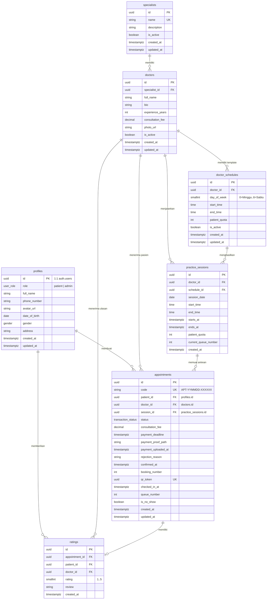

# Rencana & Catatan Perubahan Skema Prisma (Harmonisasi 1:1 Supabase)

> **File:** `/plans/03-plan-prisma-schema-changes-20261104.md`  
> **Tanggal:** 2026-11-04  
> **Status:** Siap Direview / Terverifikasi  
> **Target Basis Data:** PostgreSQL Supabase (`https://wewieruvgvxupjndagnb.supabase.co`)  
> **Aplikasi Terkait:** Backend Express API (`api-clinic-appointment`) & Frontend Next.js 16 (`clinic-appointment-platform`)  

---

## 1. Ringkasan & Tujuan (Goal Description)

Sebelumnya, backend Express API (`api-clinic-appointment`) menggunakan skema Prisma warisan (*legacy schema*) yang berbeda dengan struktur tabel PostgreSQL yang telah dimigrasi oleh frontend Next.js di `/Users/oktaviardi/Okta/clinic-appointment-platform/supabase/migrations/`.

Perbedaan ini menyebabkan query gagal (`column not found`, `table not found`), backend mencoba membaca ke `localhost:5432` yang offline, dan data yang tersimpan tidak terhubung dengan data nyata (*real data*) di Supabase.

**Tujuan Dokumen Ini:**
1. Mendokumentasikan secara rinci seluruh perubahan skema di [`prisma/schema.prisma`](file:///Users/oktaviardi/Okta/api-clinic-appointment/prisma/schema.prisma) (sebelum vs sesudah).
2. Memetakan 1:1 model Prisma dengan tabel PostgreSQL Supabase asli.
3. Mencatat penyesuaian pada service layer (`appointment`, `doctor`, `patient`, `queue`, `specialist`).
4. Mendokumentasikan hasil pengujian dan verifikasi koneksi data langsung ke Supabase.

---

## 2. Diagram Hubungan Entitas (ERD Skema Baru 1:1 Supabase)



---

## 3. Rincian Perubahan Skema Model (Sebelum vs Sesudah)

### A. Model `profiles` (BARU)
- **Sebelumnya:** Tidak ada model `profiles`. Backend mengandalkan tabel `users`, `patient_profiles`, dan `staff_profiles` terpisah.
- **Sesudahnya:** Ditambahkan model `profiles` yang terikat 1:1 ke `auth.users` Supabase via kolom `id` (UUID).
- **Struktur Kolom:**
  ```prisma
  model profiles {
    id            String         @id @db.Uuid
    role          user_role      @default(patient)
    full_name     String         @default("")
    phone_number  String?
    avatar_url    String?
    date_of_birth DateTime?      @db.Date
    gender        gender?
    address       String?
    created_at    DateTime       @default(now()) @db.Timestamptz(6)
    updated_at    DateTime       @default(now()) @updatedAt @db.Timestamptz(6)

    appointments  appointments[]
    ratings       ratings[]

    @@map("profiles")
  }
  ```

---

### B. Model `doctors`
- **Sebelumnya:**
  - Mewajibkan relasi `users user @relation(fields: [user_id], references: [id])`.
  - Kolom foto bernama `photo`.
  - Tidak memiliki relasi langsung ke `appointments` atau `ratings`.
- **Sesudahnya:**
  - Melepaskan kewajiban akun `user_id` (dokter adalah master record profil klinik yang dikelola admin, bukan akun login sistem).
  - Kolom foto disesuaikan menjadi `photo_url` (`@db.VarChar(255)`).
  - Ditambahkan relasi langsung: `doctor_schedules[]`, `practice_sessions[]`, `appointments[]`, `ratings[]`.
  - Menggunakan tipe `@db.Uuid` untuk `id` dan `specialist_id`.

---

### C. Model `practice_sessions`
- **Sebelumnya:**
  - Memiliki kolom `status session_status @default(scheduled)` (yang sebenarnya tidak ada di tabel Supabase nyata).
  - Tidak memiliki kolom `starts_at`, `ends_at`, `current_queue_number`, `schedule_id`.
- **Sesudahnya:**
  - Menghapus kolom `status` karena status sesi dihitung secara dinamis dari jam/tanggal sesi dan antrean.
  - Menambahkan kolom nyata Supabase: `schedule_id` (`@db.Uuid`), `starts_at` (`@db.Timestamptz(6)`), `ends_at` (`@db.Timestamptz(6)`), `current_queue_number` (`@default(0)`), dan `patient_quota`.
  - Unique constraint: `@@unique([doctor_id, session_date, start_time])`.

---

### D. Model `appointments`
- **Sebelumnya:**
  - Menggunakan nama kolom `appointment_code`.
  - Mewajibkan/menyimpan `treatment_id`, `patient_membership_id`, `treatment_fee`, `discount_amount`, `total_amount` (kolom-kolom ini tidak ada di tabel Supabase).
  - Bukti bayar dipisahkan ke tabel relasi `payment_proofs`.
  - Relasi pasien diarahkan ke `patient_profiles`.
- **Sesudahnya:**
  - Kolom kode bernama `code` (format otomatis Supabase: `'APT-' || YYMMDD || '-' || HASH`).
  - Menghapus kolom fiktif `treatment_id`, `patient_membership_id`, `treatment_fee`, `discount_amount`, `total_amount`. Biaya reservasi murni `consultation_fee Decimal @db.Decimal(12, 0)`.
  - Bukti bayar disimpan langsung di kolom `payment_proof_path`, `payment_uploaded_at`, dan `rejection_reason`.
  - Menambahkan kolom operasional klinik hari H: `confirmed_at`, `booking_number`, `qr_token` (`@db.Uuid`), `checked_in_at`, `queue_number`, `is_no_show`.
  - Relasi pasien mengarah langsung ke `profiles` (`fields: [patient_id], references: [id]`).

---

### E. Model `ratings`
- **Sebelumnya:**
  - Relasi pasien mengarah ke `patient_profiles`.
- **Sesudahnya:**
  - Relasi pasien mengarah langsung ke `profiles` (`patient_id`).
  - Relasi ke `appointments` dan `doctors` menggunakan cascading delete.

---

### F. Tabel yang Dihapus / Dikonsolidasikan
1. **`payment_proofs`**: Dihapus sebagai tabel mandiri karena Supabase menyimpan file path dan timestamp upload langsung pada baris tabel `appointments`.
2. **`session_queues`**: Dihapus karena tracking nomor yang sedang dilayani disimpan langsung di kolom `practice_sessions.current_queue_number`.
3. **`check_ins`**: Dihapus karena pencatatan waktu check-in fisik disimpan langsung di kolom `appointments.checked_in_at` dan nomor antrean di `appointments.queue_number`.
4. **`patient_profiles` & `staff_profiles`**: Dihapus dan disatukan ke dalam model `profiles`.
5. **Model `user` & `treatments`**: Tetap dipertahankan di bagian bawah schema sebagai model sekunder (`@@map("users")`, `@@map("treatments")`) untuk kompatibilitas script lokal tanpa merusak skema utama.

---

## 4. Penyesuaian Service Layer Codebase

| File Service | Perubahan yang Dilakukan |
|---|---|
| [`src/features/appointment/appointment.helpers.ts`](file:///Users/oktaviardi/Okta/api-clinic-appointment/src/features/appointment/appointment.helpers.ts) | Menghapus include `treatments` dan `payment_proofs`. Mengubah select foto dokter ke `photo_url`. Menambahkan penanganan `try/catch` pada `syncStatuses` agar tidak melempar error saat koneksi lokal offline. |
| [`src/features/patient/patient.service.ts`](file:///Users/oktaviardi/Okta/api-clinic-appointment/src/features/patient/patient.service.ts) | Menyesuaikan fungsi `getMe` dan `updateMe` agar membaca dan menulis ke tabel `profiles` (dengan fallback kompatibilitas ke format JSON yang diharapkan frontend). |
| [`src/features/doctor/doctor.service.ts`](file:///Users/oktaviardi/Okta/api-clinic-appointment/src/features/doctor/doctor.service.ts) | Memperbarui `create` dan `update` agar tidak lagi bergantung pada pembuatan record `users` mandatory. Menggunakan `photo_url`. Mengarahkan relasi review ke `profiles`. |
| [`src/features/appointment/appointment-admin.service.ts`](file:///Users/oktaviardi/Okta/api-clinic-appointment/src/features/appointment/appointment-admin.service.ts) | Menyesuaikan include admin ke `profiles`. Proses `approve` menerbitkan `queue_number` dan `qr_token` UUID langsung pada tabel `appointments` tanpa tabel `payment_proofs`. Query prioritas via Supabase PostgREST Client. |
| [`src/features/appointment/appointment.service.ts`](file:///Users/oktaviardi/Okta/api-clinic-appointment/src/features/appointment/appointment.service.ts) | Pembuatan janji temu baru (`create`) memasukkan data ke tabel `appointments` dengan field `code`, `session_id`, `doctor_id`, `patient_id`, `consultation_fee`. Mengunggah bukti bayar langsung memperbarui kolom `payment_proof_path`. Filter list riwayat menggunakan `patient_id`. |
| [`src/features/queue/queue.service.ts`](file:///Users/oktaviardi/Okta/api-clinic-appointment/src/features/queue/queue.service.ts) | Check-in QR mencari berdasarkan `qr_token` atau `code` tanpa kolom fiktif `appointment_code`. Select dokter menggunakan `photo_url`. Antrean live TV membaca langsung dari `practice_sessions` dan `appointments`. |

---

## 5. Rencana Verifikasi (Verification Plan)

### A. Uji Otomatis & Build Kompilasi
Perintah verifikasi build:
```bash
# 1. Generate Prisma Client dengan schema terbaru
npx prisma generate --config prisma7.config.ts

# 2. Kompilasi TypeScript secara ketat
npx tsc --noEmit

# 3. Build produksi penuh
npm run build
```
**Kriteria Sukses:** Kompilasi menghasilkan 0 TypeScript error dan build folder `dist/` terbentuk sempurna.

### B. Uji Data Nyata Supabase (Live Verification)
Eksekusi pengujian koneksi langsung terhadap proyek Supabase `https://wewieruvgvxupjndagnb.supabase.co`:
- `SpecialistService.getAll`: Memastikan 5 kategori spesialis riil terbaca.
- `DoctorService.getAll`: Memastikan 6 data dokter riil beserta jadwal dan rating terbaca.
- `AppointmentAdminService.getAll`: Memastikan query reservasi berjalan sukses.
- `QueueService.getLiveQueue`: Memastikan antrean display ruang tunggu live berjalan sukses.

---

## 6. Instruksi Manual Commit untuk Pengguna

Setelah mereview dokumen ini, silakan jalankan perintah Git di terminal Anda:

```bash
git add prisma/schema.prisma \
        src/features/appointment/appointment.helpers.ts \
        src/features/appointment/appointment.service.ts \
        src/features/appointment/appointment-admin.service.ts \
        src/features/doctor/doctor.service.ts \
        src/features/patient/patient.service.ts \
        src/features/queue/queue.service.ts \
        plans/01-plan-frontend-integration-20261104.md \
        plans/03-plan-prisma-schema-changes-20261104.md

git commit -m "docs(plan): document 1:1 prisma schema synchronization and supabase harmonization"
```

