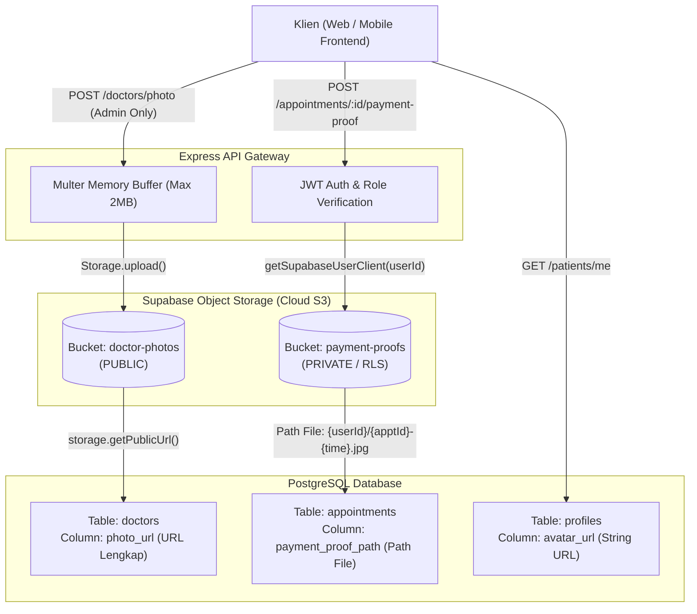

# Notes 06: Mekanisme dan Arsitektur Penyimpanan Media (Bukti Bayar, Foto Dokter, dan Avatar Pasien)

> **File:** `plans/06-notes-media-storage-mechanisms-20261105.md`  
> **Konteks:** Perbandingan Lokasi, Hak Akses, Pipeline Teknis, dan Keamanan Penyimpanan Gambar  
> **Tanggal:** 2026-11-05  
> **Status:** APPROVED & DOCUMENTED  

---

## 📌 Ringkasan Eksekutif

Pertanyaan Inti:
> *"Di mana foto bukti bayar, dokter, dan pasien tersimpan? Apakah sama mekanismenya dan bagaimana teknisnya?"*

**Jawaban Singkat:**
- **Infrastruktur Fisik**: **SAMA-SAMA** menggunakan **Supabase Storage** (*Object Storage* berbasis AWS S3) yang dikelola melalui SDK `@supabase/supabase-js`.
- **Mekanisme Hak Akses & Keamanan**: **BERBEDA**. Foto dokter bersifat **publik terbuka**, sedangkan bukti bayar bersifat **privat dan terikat otorisasi pengguna (RLS)** untuk melindungi privasi finansial pasien.



---

## 📊 Matriks Perbandingan Detail

| Komponen | 1. Foto Dokter | 2. Bukti Pembayaran Pasien | 3. Avatar / Foto Profil Pasien |
| :--- | :--- | :--- | :--- |
| **Lokasi Bucket Fisik** | Bucket `doctor-photos` di Supabase Storage | Bucket `payment-proofs` di Supabase Storage | Kolom `avatar_url` (URL eksternal / Supabase bucket) |
| **Kolom Database** | `doctors.photo_url` (`text`) | `appointments.payment_proof_path` (`text`) | `profiles.avatar_url` (`text`) |
| **Format yang Disimpan di DB** | URL Publik absolut (`https://.../doctor-photos/...`) | Relative Path (`{userId}/{apptId}-{time}.jpg`) atau Base64 Data URL | URL string avatar |
| **Sifat Hak Akses (ACL)** | **Publik (Public Read)** | **Privat & Terproteksi (Private)** | **Terproteksi (RLS Auth)** |
| **Siapa yang Boleh Melihat?** | Siapa saja (Guest, Pasien, Admin) tanpa login | Hanya Pasien pemilik janji temu & Admin klinik | Pasien pemilik akun & Admin klinik |
| **Client yang Mengunggah** | Service Role / Anon Supabase Client | **User-Scoped Authenticated Client** (`getSupabaseUserClient(userId)`) | User Client saat update profil |
| **Otorisasi Upload** | Admin Only (`verifyRole('ADMIN')`) | Pasien Pemilik Booking Aktif (`status = waiting_payment`) | Pasien yang bersangkutan |
| **Endpoint Terkait** | `POST /api/v1/doctors/photo` | `POST /api/v1/appointments/:id/payment-proof` | `PATCH /api/v1/patients/me` |

---

## 🛠 Rincian Teknis Implementasi

### 1. Foto Dokter (`doctor-photos`)

- **Pipeline Ingestion**:
  1. File gambar diunggah melalui endpoint `POST /api/v1/doctors/photo` menggunakan middleware `uploadSingleImage('photo')` (Multer RAM buffer, maksimal 2MB).
  2. Fungsi `DoctorService.uploadPhoto` memanggil `Storage.upload()` di `src/lib/supabase.lib.ts`.
  3. Format penamaan file di storage:
     ```text
     doctors/{timestamp}-{randomHex4}.{extension}
     ```
  4. Karena bucket `doctor-photos` disetel sebagai **Public Bucket**, Supabase langsung menghasilkan CDN URL permanen melalui:
     ```typescript
     storage.getPublicUrl(path).data.publicUrl;
     ```
  5. URL ini disimpan ke kolom `doctors.photo_url` dan langsung disajikan ke frontend katalog publik tanpa perlu token autentikasi.

---

### 2. Foto Bukti Bayar Pasien (`payment-proofs`)

- **Keamanan Finansial**: Struk transfer bank memuat informasi sensitif (nama rekening, nomor rekening, nominal transfer). Oleh karena itu, bukti bayar **TIDAK BOLEH** disimpan di bucket publik.
- **Pipeline Ingestion & RLS Guard**:
  1. Pasien mengirim file via `POST /api/v1/appointments/:id/payment-proof`.
  2. Middleware memvalidasi status janji temu (harus `waiting_payment` dan belum melewati `payment_deadline`).
  3. Backend membuat client Supabase yang membawa Bearer Token user pasien:
     ```typescript
     const userClient = await getSupabaseUserClient(userId);
     ```
  4. File diunggah ke bucket privat `payment-proofs` dengan struktur hierarki folder per *patient ID*:
     ```text
     {userId}/{appointment.id}-{Date.now()}.{extension}
     ```
  5. Upload ini lolos evaluasi RLS Supabase Storage karena folder pertama cocok dengan `auth.uid()`.
  6. Backend memanggil RPC Supabase `submit_payment_proof` (SECURITY DEFINER) yang secara atomik mengubah status transaksi menjadi `waiting_confirmation`, mencatat timestamp `payment_uploaded_at`, dan menyimpan file path ke `appointments.payment_proof_path`.

---

### 3. Foto Avatar Pasien (`profiles.avatar_url`)

- Pasien dapat memperbarui foto profil atau identitas mereka melalui `PATCH /api/v1/patients/me`.
- Nilai `avatar_url` disimpan langsung di tabel PostgreSQL `public.profiles`.
- Akses pembacaan data dibatasi oleh PostgreSQL Row-Level Security:
  ```sql
  CREATE POLICY "profiles: baca milik sendiri atau admin"
  ON public.profiles FOR SELECT TO authenticated
  USING ((id = auth.uid()) OR is_admin());
  ```
  Artinya pengguna lain tidak dapat mengintip avatar atau data identitas pasien lain melalui API.

---

## 🔒 Konfigurasi Environment Variables Terkait Storage

Konfigurasi ini dikelola di file `.env` dan diselaraskan pada `src/lib/supabase.lib.ts`:

```env
# URL dan Kunci Supabase
SUPABASE_URL=https://wewieruvgvxupjndagnb.supabase.co
SUPABASE_SERVICE_ROLE_KEY=your-service-role-key
SUPABASE_ANON_KEY=your-anon-key

# Nama Bucket Storage Terpisah
SUPABASE_BUCKET_DOCTOR_PHOTOS=doctor-photos    # Bucket Publik
SUPABASE_BUCKET_PAYMENT_PROOFS=payment-proofs  # Bucket Privat Terproteksi
```

---

## ✅ Kesimpulan Arsitektural

1. **Efisiensi Penyimpanan**: Database PostgreSQL hanya menyimpan string path atau URL metadata ringan, bukan binary BLOB, menjaga ukuran database tetap ramping dan *query execution* cepat.
2. **Separasi Privasi**: Pemisahan bucket `doctor-photos` (publik) dan `payment-proofs` (privat) menjamin aset pemasaran klinik mudah diakses publik tanpa mengorbankan privasi data transaksi pasien.
3. **Resiliensi Pengujian**: Backend Express juga mendukung parsing fallback Base64 data URL (`data:image/...;base64,...`) sehingga pengujian antrean dan pembayaran tetap dapat berjalan lancar saat *offline testing*.

