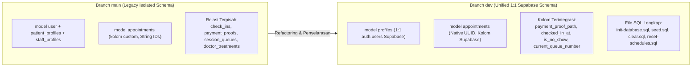

# Plan 07: Perbandingan dan Rincian Perubahan Skema Database (Branch `main` vs `dev`)

> **File:** `plans/07-plan-schema-changes-main-vs-dev-20261105.md`  
> **Konteks:** Audit Komparasi Skema Prisma & Basis Data PostgreSQL / Supabase  
> **Tanggal:** 2026-11-05  
> **Status:** COMPLETED & VERIFIED  

---

## 📌 Ringkasan Eksekutif

Branch `dev` telah melalui refactoring arsitektur besar untuk menyelaraskan skema database **1:1 secara identik dengan Supabase PostgreSQL** yang digunakan oleh aplikasi frontend (`clinic-appointment-platform`). 

Di branch `main`, skema masih menggunakan model relasional lama yang terfragmentasi (banyak tabel perantara seperti `check_ins`, `payment_proofs`, `session_queues`, `doctor_treatments`, dan tipe ID berbasis generic string). Di branch `dev`, seluruh model telah disederhanakan, dioptimalkan, mengadopsi tipe data asli PostgreSQL (`@db.Uuid`, `@db.Date`, `@db.Timestamptz`), dan dilengkapi file inisialisasi SQL DDL serta seed terpadu.

---

## 📊 Matriks Perbandingan Model & Tabel

| Model / Tabel | Status di `main` | Status di `dev` | Keterangan Perubahan |
| :--- | :--- | :--- | :--- |
| **`profiles`** | ❌ Belum ada (menggunakan `patient_profiles` terpisah) | ✅ **Ada** (`model profiles`) | Memetakan 1:1 ke `public.profiles` Supabase. Berisi `full_name`, `phone_number`, `avatar_url`, `date_of_birth`, `gender`, `address`. |
| **`user` (`users`)** | Menjadi tabel utama entitas pengguna | Dipertahankan sebagai model fallback autentikasi lokal | Menjamin kompatibilitas mundur dengan controller Express. |
| **`patient_profiles`** | Tabel terpisah relasi ke `user` | 🗑️ **Dihapus** | Disatukan langsung ke dalam `profiles`. |
| **`staff_profiles`** | Tabel relasional staf | 🗑️ **Dihapus** | Tidak digunakan di skema Supabase. |
| **`doctors`** | Kolom foto: `photo` | Kolom foto: **`photo_url`** | Selaras dengan Supabase. ID menggunakan `@db.Uuid`. |
| **`doctor_schedules`** | ID berbasis generic String | ID menggunakan **`@db.Uuid`** | Relasi langsung ke `doctors`. |
| **`practice_sessions`** | Hanya `session_date`, `start_time`, `end_time` | Ditambahkan **`starts_at`**, **`ends_at`**, dan **`current_queue_number`** | Mengeliminasi kebutuhan tabel antrean terpisah (`session_queues`). |
| **`session_queues`** | Tabel terpisah untuk nomor antrean | 🗑️ **Dihapus** | Dilacak langsung di kolom `practice_sessions.current_queue_number`. |
| **`appointments`** | Kolom lama: `appointment_code`, `treatment_id`, relasi ke `payment_proofs` & `check_ins` | Kolom baru: **`code`**, **`payment_proof_path`**, **`payment_uploaded_at`**, **`rejection_reason`**, **`confirmed_at`**, **`is_no_show`** | Terintegrasi penuh dengan Supabase RPC `submit_payment_proof` & `check_in`. |
| **`payment_proofs`** | Tabel relasional terpisah | 🗑️ **Dihapus** (diserap ke `appointments`) | File path bukti bayar disimpan di `appointments.payment_proof_path`. |
| **`check_ins`** | Tabel relasional terpisah | 🗑️ **Dihapus** (diserap ke `appointments`) | Status check-in disimpan di `checked_in_at` dan `is_no_show`. |
| **`doctor_treatments`** | Tabel many-to-many dokter & treatment | 🗑️ **Dihapus** | Dokter dapat melayani seluruh treatment sesuai bidang keahliannya. |
| **`ratings`** | Berelasi ke `user` & `patient_profiles` | Berelasi ke **`profiles`** & **`appointments`** | Menggunakan `@db.Uuid` dan `@db.SmallInt` untuk bintang (1-5). |
| **`membership_plans` / `patient_memberships`** | Ada di skema | 🗑️ **Dihapus** | Tidak ada pada skema Supabase klinik aktif. |
| **`notifications`** | Ada di skema | 🗑️ **Dihapus** | Tidak ada pada skema Supabase klinik aktif. |

---

## 🔠 Perubahan ENUM (Tipe Data Kustom)

| Enum | Di Branch `main` | Di Branch `dev` | Catatan |
| :--- | :--- | :--- | :--- |
| **`user_role`** | ❌ Belum ada | ✅ **`patient`**, **`admin`** | Enum standar Supabase untuk tabel `profiles`. |
| **`gender`** | Bernama `gender_type` | Bernama **`gender`** (`male`, `female`, `other`) | Selaras dengan Supabase. |
| **`transaction_status`** | `waiting_payment`, `waiting_confirmation`, `done`, `rejected`, `expired`, `canceled` | `waiting_payment`, `waiting_confirmation`, `done`, `rejected`, `expired`, `canceled` | Sama, status transaksi reservasi. |
| **`checkin_status`** | `checked_in`, `no_show` | `checked_in`, `no_show` | Dipertahankan. |
| **`role`** | `PATIENT`, `ADMIN`, `STAFF`, `DOCTOR` | `PATIENT`, `ADMIN`, `STAFF`, `DOCTOR` | Enum peran aplikasi Express. |
| **`membership_status`** | Ada | 🗑️ Dihapus | - |
| **`session_status`** | Ada | 🗑️ Dihapus | - |
| **`verification_status`** | Ada | 🗑️ Dihapus | - |

---

## 📁 File Skrip SQL Baru di Branch `dev` (`prisma/*.sql`)

Branch `dev` menyertakan 4 file SQL modular yang tidak ada di branch `main`:

1. **`prisma/init-database.sql` (1.339 baris)**:
   - Skema DDL lengkap: Ekstensi PostgreSQL (`pgcrypto`, `uuid-ossp`), ENUMs, seluruh tabel relasional, triggers `updated_at`.
   - Fungsi RPC Supabase: `is_admin()`, `check_in()`, `call_next()`, `mark_no_show()`, `approve_appointment()`, `reject_appointment()`, `submit_payment_proof()`.
   - Row-Level Security (RLS) policies lengkap.
   - Seed data awal: 14 treatments, 5 spesialis, 6 dokter, akun Admin, Pasien Demo, serta Pasien 1, 2, dan 3.

2. **`prisma/seed.sql` (639 baris)**:
   - Script SQL mandiri untuk mengisi data dummy (dokter, jadwal mingguan, sesi praktik hari ini & masa lalu, ulasan rating bintang 5, dan akun testing).

3. **`prisma/clear.sql` (31 baris)**:
   - Script `TRUNCATE TABLE ... CASCADE` untuk mengosongkan data transaksi dan master secara aman tanpa merusak struktur tabel.

4. **`prisma/reset-schedules.sql` (113 baris)**:
   - Script khusus untuk me-reset jam praktik dokter dan men-generate otomatis sesi praktik aktif untuk 14 hari ke depan dalam format WIB (`Asia/Jakarta`).

---

## 🛠 Perubahan Skrip NPM di `package.json`

| NPM Command | Branch `main` | Branch `dev` | Fungsi |
| :--- | :--- | :--- | :--- |
| `npm run db:init` | ❌ Tidak ada | ✅ `tsx src/scripts/db-init.ts` | Inisialisasi skema database dari nol via `init-database.sql` |
| `npm run db:seed` | ❌ Tidak ada | ✅ `tsx src/scripts/seed.ts` | Injeksi dummy dataset lengkap via `seed.sql` |
| `npm run db:clear` | ❌ Tidak ada | ✅ `tsx src/scripts/db-clear.ts` | Mengosongkan data via `clear.sql` |
| `npm run db:reset-schedules` | ❌ Tidak ada | ✅ `tsx src/scripts/reset-schedules.ts` | Reset jadwal & generate 14 hari sesi praktik |
| `npm run clear` | ❌ Tidak ada | ✅ Alias untuk `db:clear` | Shortcut CLI |
| `npm run seed` | ❌ Tidak ada | ✅ Alias untuk `db:seed` | Shortcut CLI |

---

## 🚀 Kesimpulan & Tindakan untuk Deployment

Perubahan skema di branch `dev` ini merupakan syarat mutlak agar backend Express dapat beroperasi harmonis dengan database Supabase Cloud dan aplikasi Frontend Next.js. 

Ketika branch `dev` di-merge ke branch `main`, seluruh peningkatan efisiensi, eliminasi tabel usang, dan kompatibilitas serverless Vercel akan otomatis aktif pada environment *production*.

