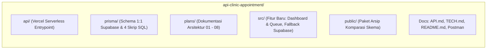

# Plan 08: Listing Perbedaan Struktur Folder dan File (Branch `main` vs `dev`) Beserta Kegunaannya

> **File:** `plans/08-plan-structure-and-file-diff-main-vs-dev-20261105.md`  
> **Konteks:** Audit Arsitektur Struktur Repositori & Komparasi Antar Branch  
> **Tanggal:** 2026-11-05  
> **Status:** COMPLETED & DOCUMENTED  

---

## 📌 Ringkasan Eksekutif

Branch `dev` merupakan cabang pengembangan aktif yang menyelaraskan backend Express dengan ekosistem **Supabase PostgreSQL & Cloud Storage**, aplikasi **Frontend Next.js**, serta kapabilitas **Vercel Serverless Deployment**.

Dibandingkan dengan branch `main`, branch `dev` memiliki penambahan modul fitur (Dashboard KPI, Antrean Live TV & Check-in), skrip manajemen database mandiri (init, seed, clear, reset-schedules), handler serverless Vercel, serta perombakan skema Prisma agar 1:1 identik dengan Supabase.

---

## 🗂 Rincian Perbedaan Struktur Folder dan File

Berikut adalah pengelompokan seluruh folder dan file yang baru ditambahkan (**A**) atau dimodifikasi (**M**) di branch `dev` beserta **tujuan / kegunaan singkatnya**:

### 1. Root & Deployment Serverless

| File / Folder | Status | Kegunaan / Tujuan |
| :--- | :---: | :--- |
| **`api/index.ts`** | **A** *(Baru)* | Entrypoint handler Vercel Serverless Function yang mengekspor instance Express `app` ke serverless runtime. |
| **`vercel.json`** | **M** *(Diubah)* | Konfigurasi modern Vercel rewrites (`/(.*) -> /api`) untuk merutekan seluruh HTTP request masuk ke Express. |
| **`package.json`** | **M** *(Diubah)* | Menambahkan perintah CLI manajemen database (`db:init`, `db:seed`, `db:clear`, `db:reset-schedules`, `clear`, `seed`), serta lifecycle `postinstall: prisma generate`. |
| **`example.env`** | **M** *(Diubah)* | Template konfigurasi environment yang memisahkan dual-bucket (`doctor-photos` & `payment-proofs`) serta panduan URL DB Supabase Pooler. |
| **`postman_collection.json`** | **A** *(Baru)* | Koleksi Postman API v2.1 lengkap dengan skrip otomatisasi token login admin & pasien untuk pengujian menyeluruh. |

---

### 2. Modul Fitur Baru (`src/features/`)

Di branch `dev`, ditambahkan 2 modul fitur baru untuk memenuhi kebutuhan operasional klinik:

| File | Status | Kegunaan / Tujuan |
| :--- | :---: | :--- |
| **`src/features/dashboard/dashboard.service.ts`** | **A** *(Baru)* | Menghitung metrik analitik dashboard admin: total pasien unik, total janji temu selesai, omzet pendapatan klinik, dan antrean menunggu konfirmasi. |
| **`src/features/dashboard/dashboard.controller.ts`** | **A** *(Baru)* | Handler endpoint HTTP untuk metrik analitik dashboard admin (`/api/v1/admin/dashboard/metrics`). |
| **`src/features/dashboard/dashboard.route.ts`** | **A** *(Baru)* | Router Express yang membatasi akses endpoint dashboard khusus role `ADMIN`. |
| **`src/features/queue/queue.service.ts`** | **A** *(Baru)* | Mengelola pemantauan antrean hari ini (`/queue/live`), check-in kehadiran pasien via QR token, pemanggilan pasien (*call next*), dan penandaan *no-show*. |
| **`src/features/queue/queue.controller.ts`** | **A** *(Baru)* | Handler HTTP untuk operasi antrean publik dan admin. |
| **`src/features/queue/queue.route.ts`** | **A** *(Baru)* | Router untuk monitor live publik TV (`GET /queue/live`) dan aksi admin (`POST /admin/queue/check-in`, dll). |

---

### 3. Fitur yang Disempurnakan (`src/features/`)

| Modul / File | Status | Kegunaan / Tujuan Penyempurnaan |
| :--- | :---: | :--- |
| **`src/features/appointment/`** | **M** | Integrasi query PostgREST Supabase dengan fallback Prisma, penyerapan bukti bayar ke `payment_proof_path`, dan penambahan proteksi `try/catch` pada sinkronisasi status kadaluarsa (`syncStatuses`). |
| **`src/features/auths/`** | **M** | Penambahan fungsionalitas ganti password (`PATCH /api/v1/auth/password`) dengan validasi ganda bcrypt lokal dan Supabase Auth `updateUser`. |
| **`src/features/patient/`** | **M** | Resolusi email otomatis pada `GET /patients/me` (agar email profil tidak kosong) dan alias rute ganti password (`PATCH /patients/me/password`). |
| **`src/features/doctor/`** | **M** | Mendukung unggah foto dokter dari file multipart (Multer) maupun Base64 string ke bucket `doctor-photos`. |
| **`src/features/schedule/`** | **M** | Pengecekan overlap jadwal praktik dokter agar tidak ada jam kerja yang bentrok pada hari yang sama. |
| **`src/features/specialist/`** | **M** | Query langsung ke Supabase dengan caching fallback ke Prisma. |

---

### 4. Lapisan Skema & Basis Data (`prisma/`)

| File | Status | Kegunaan / Tujuan |
| :--- | :---: | :--- |
| **`prisma/schema.prisma`** | **M** *(Diubah)* | Refactoring model 1:1 ke Supabase (`model profiles`, native `@db.Uuid`), menghilangkan 6 tabel perantara yang redundan (`check_ins`, `payment_proofs`, `session_queues`, `doctor_treatments`, `staff_profiles`, `notifications`). |
| **`prisma/init-database.sql`** | **A** *(Baru)* | Skrip SQL konsolidasi DDL (tabel, enum, ekstensi, fungsi RPC atomik, policy RLS, dan seed awal 14 treatments, dokter, serta akun demo). |
| **`prisma/seed.sql`** | **A** *(Baru)* | Dataset dummy pengujian lengkap (jadwal praktik, sesi hari ini & masa lalu, rating bintang 5, akun Pasien 1, 2, dan 3). |
| **`prisma/clear.sql`** | **A** *(Baru)* | Skrip pembersih data transaksi & master menggunakan `TRUNCATE ... CASCADE` secara aman. |
| **`prisma/reset-schedules.sql`** | **A** *(Baru)* | Skrip reset jam praktik dokter dan auto-generate sesi praktik untuk 14 hari ke depan (format WIB). |

---

### 5. Skrip Otomasi Database (`src/scripts/`)

| File Script | Status | Kegunaan / Tujuan |
| :--- | :---: | :--- |
| **`src/scripts/db-init.ts`** | **A** *(Baru)* | CLI runner untuk mengeksekusi `prisma/init-database.sql` via `npm run db:init`. |
| **`src/scripts/seed.ts`** | **A** *(Baru)* | CLI runner untuk mengeksekusi `prisma/seed.sql` via `npm run db:seed`. |
| **`src/scripts/db-clear.ts`** | **A** *(Baru)* | CLI runner untuk mengosongkan tabel via `npm run db:clear`. |
| **`src/scripts/reset-schedules.ts`** | **A** *(Baru)* | CLI runner untuk reset jam praktik via `npm run db:reset-schedules`. |

---

### 6. Validator Zod Baru (`src/validators/`)

| File Validator | Status | Kegunaan / Tujuan |
| :--- | :---: | :--- |
| **`src/validators/dashboard.validator.ts`** | **A** *(Baru)* | Validasi parameter query metrik dashboard analitik. |
| **`src/validators/queue.validator.ts`** | **A** *(Baru)* | Validasi payload QR token check-in, panggilan antrean (*call next*), dan *no-show*. |
| **`src/validators/auth.validator.ts`** | **M** | Menambahkan skema validasi `changePasswordSchema` (min 8 karakter). |
| **`src/validators/validators.config.ts`** | **M** | Relaksasi validasi UUID agar mendukung UUID sintetis untuk data seed dan testing. |

---

### 7. Konfigurasi, Utilitas & Middleware (`src/configs/`, `src/lib/`, `src/middlewares/`)

| File | Status | Kegunaan / Tujuan |
| :--- | :---: | :--- |
| **`src/configs/cors.config.ts`** | **M** | Penanganan CORS fleksibel untuk Next.js SSR, localhost, domain preview `*.vercel.app`, dan wildcard `*` tanpa melempar unhandled exception. |
| **`src/lib/supabase.lib.ts`** | **M** | Abstraksi Supabase Client multi-mode (Anon, Service Role, dan User-Scoped Client dengan Bearer Token) serta helper dual-bucket storage. |
| **`src/lib/time.lib.ts`** | **M** | Utilitas normalisasi tanggal, waktu, dan zona waktu WIB (`Asia/Jakarta`). |
| **`src/server.ts`** | **M** | Pendaftaran router baru (`/dashboard`, `/queue`, `/health`) dan fallback port/prefix yang tahan terhadap serverless runtime. |

---

### 8. Dokumentasi & Perencanaan Teknis

| File / Folder | Status | Kegunaan / Tujuan |
| :--- | :---: | :--- |
| **`API.md`** | **A** *(Baru)* | Spesifikasi lengkap seluruh REST API Express beserta format request body, respons JSON, dan contoh cURL. |
| **`TECH.md`** | **A** *(Baru)* | Arsitektur teknis mendalam: konkurensi kuota (`SELECT FOR UPDATE`), RLS policies, RBAC matrix, dan pipeline memori Multer. |
| **`README.md`** | **A** *(Baru)* | Panduan instalasi komprehensif, alur `db:init`, `db:clear`, dan tabel akun demo. |
| **`AGENT.md`** | **A** *(Baru)* | Panduan konteks dan aturan instruksi agen pengembang AI. |
| **`plans/01` s/d `07`** | **A** *(Baru)* | Rangkaian dokumen audit integrasi frontend, deployment Vercel, komparasi skema, dan catatan teknis media storage. |
| **`public/`** | **A** *(Baru)* | Berisi paket file ZIP (`schema-changes-main-vs-dev.zip`) dan direktori perbandingan skema siap buka. |

---

## 📌 Kesimpulan Ringkas

Branch **`dev`** memutakhirkan proyek dari yang sebelumnya berupa prototipe API monolitik lokal (di branch `main`) menjadi **layanan API kelas produksi yang siap dideploy di Vercel Serverless**, terintegrasi penuh dengan **Supabase Cloud**, dan memiliki **manajemen antrean klinik real-time**.

